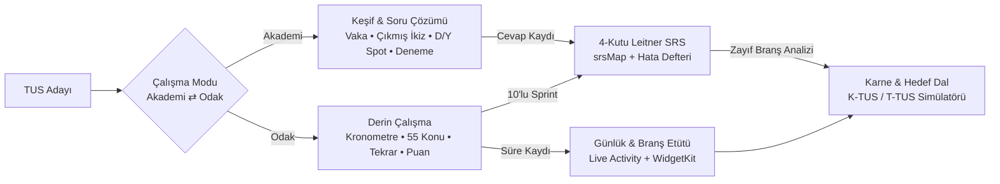

# 01 — Ürün Vizyonu, Rekabet Analizi ve Sadelik Bildirgesi (v1.4)

## 1. Stratejik Amaç ve Konumlandırma

**TUS Vaka & Spot Akademi (`com.tus.akademi`)**, tıp fakültesi öğrencileri, intern hekimler, nöbetteki pratisyen/asistan adayları ve yoğun kamp dönemindeki TUS adayları için geliştirilmiş; **%100 internetsiz (offline)** çalışan, düşük termal/pil tüketimli, yüksek odaklı bir TUS hazırlık platformudur.

v1.4 sürümünün temel stratejisi, piyasadaki olgun TUS çalışma araçlarının (referans: **TUS Buddy**) tüm **çevrimdışı güçlü yanlarını** (ders bazlı kronometre, konu/tur takibi, aralıklı tekrar, deneme simülasyonu ve puan/branş rehberi) tek çatı altında toplarken; dikkat dağıtıcı sosyal/online özellikleri kasıtlı olarak dışarıda bırakmaktır. Bunun yerine uygulama, **OKX TR / Binance** tarzı **Çift Çalışma Modu (`Akademi ⇄ Odak`)**, **ÖSYM Konsept İkizleri (`2019–2025`)** ve **yerel iOS WidgetKit + ActivityKit Canlı Etkinlik (Kilit Ekranı & Dynamic Island)** deneyimiyle ayrışır.

> **Ticari Model:** Abonelik veya tekrarlayan ücret yoktur. İlk `30` soru/spot ücretsiz demo (`FREE_QUESTION_LIMIT = 30`) sonrası tüm içerik ve deneme modları tek seferlik **Ömür Boyu Tam Erişim (`com.tus.akademi.lifetime.pro` — `200,00 ₺`)** ile açılır.

---

## 2. Modül-Modül Çevrimdışı Rekabet Analizi (TUS Buddy Kıyaslaması)

| Modül / Özellik Alanı | TUS Buddy (Piyasa Referansı) | TUS Vaka & Spot Akademi (v1.4) | Ürün Farkı & Teknik Üstünlük |
|---|---|---|---|
| **TUS Kronometresi & Pomodoro** | Ders kronometresi, Pomodoro ve ana ekran widgetı | **Serbest Kronometre + 25 dk Pomodoro + 50 dk Blok** + ders bazlı süre kaydı (`studySecondsByDate`, `branchStudySeconds`) | Duvar saati (`startedAtMs`) tabanlı 0-CPU motor + **iOS Kilit Ekranı & Dynamic Island Canlı Etkinliği** (`TusStudyLiveActivity`) |
| **Konu & Tur Takibi** | Ders ve alt başlık bazlı konu ilerleme takibi | **55 Çekirdek TUS Konusu** (`TUS_CORE_TOPICS`: 11 branş × 5 ana konu) + tek dokunuş **`0 → 1 → 2 → 3. Tur`** döngüsü | Karmaşık ağaç menüler yok; tek dokunuşla tur artırımı, `TTBT / KTBT` filtresi ve genel tur tamamlama yüzdesi |
| **Tekrar Kartları (Spaced Repetition)** | Algoritmik tekrar kartları | **Otomatik 4-Kutu Leitner SRS** (`srsMap`: Yanlış → Kutu 1, Doğru → `+2g / +6g / +18g`) + **Nöbet Molası 10'lu Hızlı Spot** | Çözülen her vaka ve D/Y spot kartı otomatik kutulanır; manuel kart oluşturma yükü olmadan zayıf halkalar eritilir |
| **Vaka Bankası & Çıkmış İkizleri** | Çıkmış soru arşivi ve ders bazlı soru çözümü | 11 branşta (`7 TTBT + 4 KTBT`) çok açılı klinik vaka + D/Y spot havuzu + **`2019–2025` ÖSYM Konsept İkizleri** | Ayırıcı tanı notları, şık eleme, klinik ipuçları (`İpucu`), **Kaldığın Yeni Sorudan Devam** (`unsolved` öncelikli kuyruk) |
| **Deneme & Klinik Hesaplayıcı** | Deneme net takibi | **4 Süreli Deneme Modu** (`15 / 25 TTBT / 25 KTBT / 40 Maraton`) + **Klinik Formül Hesaplayıcıları** (Anyon Açığı/Winter, FENa, Parkland, Düzeltilmiş Ca/Na) + Klinik Rehber | Tek ekranda 4 yanlış 1 doğruyu götüren ÖSYM neti (`calculateOsymNet`) ve başucu klinik formülleri |
| **Puan & Branş Rehberi** | Puan hesaplama ve taban puan tabloları | Offline **`T-TUS` & `K-TUS` Simülatörü** (`calculateOfficialStyleTusScores`) + **17 Uzmanlık Dalı Hedef Bandı** (`TUS_SPECIALTY_TARGETS`) | Kullanıcının kendi TTBT/KTBT doğruluk oranından tek tıkla otomatik veri çekip hedef dal ile puan farkını gösterir |
| **Navigasyon & Odak Mimarisi** | Sabit çoklu sekme yapısı | **OKX TR / Binance Çift Mod (`Akademi ⇄ Odak`)** (`uiMode: 'akademi' \| 'odak'`) | `Odak` modunda altta **Tek Merkez İkon (`⚡ Etüt Menüsü`)** + Bottom Sheet ile sıfır dikkat dağınıklığı |
| **Sosyal / Online Özellikler** | Çalışma odaları, sıralama, tercih anketleri, canlı akış | **Kasıtlı Olarak Hariç Tutuldu** | %100 offline çalışma garantisi, sıfır sunucu gecikmesi, sıfır sosyal karşılaştırma stresi |

---

## 3. Online ve Sosyal Özelliklerin Neden Dışarıda Bırakıldığı

TUS hazırlığı yüksek bilişsel yük ve uzun süreli odaklanma gerektirir. Çevrimiçi/sosyal modüllerin ürün kapsamı dışında bırakılması 4 mimari ve pedagojik karara dayanır:

1. **Hastane ve Nöbet Alanlarında Kesintisiz Erişim:** Acil servis, yoğun bakım, ameliyathane dinlenme odaları veya metro/uçak gibi internet erişiminin zayıf veya kapalı olduğu ortamlarda uygulama açılış süresi `< 1 saniye` kalır; hiçbir ağ hatası veya oturum düşmesi yaşanmaz.
2. **Sıfır Bilişsel Gürültü ve Kaygı Azaltma:** Sıralama tabloları, anlık bildirim akışları veya forum tartışmaları yerine yalnızca adayın kendi net artışı, seri günü (`streakDays`), etüt süresi ve hedef dal farkı öne çıkarılır.
3. **Gizlilik ve Sıfır Hesap Bariyeri:** Üyelik, şifre, e-posta doğrulama veya bulut senkronizasyon zorunluluğu yoktur. Tüm veriler cihaz içinde (`localStorage` + JSON yedekleme + Keychain paylaşımı) güvenle saklanır.
4. **Termal ve Pil Verimliliği:** Arka plan soket bağlantıları, periyodik API yoklamaları ve push sunucu trafiği olmadığı için pil tüketimi ve cihaz ısınması minimumdadır.

---

## 4. Ürüne Eklenen Temel Yenilikler ve Sistem Tasarımı

### 4.1. OKX TR / Binance İlhamlı Çift Mod (`Akademi ⇄ Odak`)
- Üst barın sol tarafında uygulama ikonunun hemen yanında sabit **`[Akademi | ⚡ Odak]`** geçiş anahtarı bulunur (`src/App.tsx`).
- **Akademi Modu:** 5 sekmeli klasik alt dock (`Ev`, `Vaka`, `⚡ Odak`, `Çıkmış`, `Spot`) ile hızlı modül geçişi sunar.
- **Odak Modu:** Alt bar tek bir merkez kapsül ikona (`⚡ Etüt Menüsü`) indirgenir. Dokunulduğunda 6 modüllü **Hızlı Çalışma Geçişi (Bottom Sheet)** açılır.

### 4.2. 55 Çekirdek TUS Konusu & 3-Tur Sistemi (`TUS_CORE_TOPICS`)
- `src/data/tusMedicalRepository.ts` içinde **11 branş × 5 çekirdek başlık = 55 konu** tanımlıdır (7 TTBT branşından 35 konu, 4 KTBT branşından 20 konu).
- Her konu `Çok Yüksek` (★) veya `Yüksek` sınav ağırlığı taşır ve `topicTours` haritasında tek dokunuşla **`0 → 1 → 2 → 3. Tur → 0`** döngüsünde güncellenir.
- İlerleme yüzdesi `totalTours / (55 × 3) × 100` formülüyle canlı hesaplanır.

### 4.3. Otomatik 4-Kutu Leitner Aralıklı Tekrar (`srsMap`) & Nöbet Molası Sprinti
- `computeNextSrsEntry()` (`src/services/studyStorage.ts`), her Vaka ve Spot cevabından sonra kartı otomatik olarak 4 kutudan birine yerleştirir:

| Kutu | Tetikleyici Kural | Tekrar Aralığı (`dueDateMs`) | UI Vurgusu |
|---|---|---|---|
| **Kutu 1 • Bugün** | Yanlış cevaplananlar + henüz `srsMap`'e girmemiş eski yanlışlar | `0 gün` (hemen tekrar) | Gül/kırmızı (`rose-500`) |
| **Kutu 2 • 2 Gün** | Kutu 1'den doğru cevapla terfi edenler | `+2 gün` (`nowMs + 2 × DAY_MS`) | Amber (`amber-500`) |
| **Kutu 3 • 6 Gün** | Kutu 2'den doğru cevapla terfi edenler | `+6 gün` (`nowMs + 6 × DAY_MS`) | Turkuaz (`teal-500`) |
| **Kutu 4 • Kalıcı** | Kutu 3'ten doğru cevapla terfi edenler (tavan) | `+18 gün` (`nowMs + 18 × DAY_MS`) | Zümrüt (`emerald-500`) |

- **Nöbet Molası: 10 Hızlı Spot (`handleStartSpotSprint`):** Yoğun nöbet aralarında 2–3 dakikada çözülebilen, öncelikle henüz görülmemiş (`unseen`) kartlardan rastgele seçilen 10 maddelik kesintisiz D/Y akışıdır.

### 4.4. Offline `T-TUS` & `K-TUS` Puan Simülatörü ve Uzmanlık Dalı Hedef Rehberi
- `calculateOfficialStyleTusScores()` 100 soruluk TTBT ve 100 soruluk KTBT üzerinden:
  - **T-TUS Ağırlığı:** `0.70 × TTBT Net + 0.30 × KTBT Net`
  - **K-TUS Ağırlığı:** `0.70 × KTBT Net + 0.30 × TTBT Net`
  - **Tahmini Puan Bandı:** `35 – 84` puan aralığında ölçeklenir (`36 + (weightedNet / 100) × 48`).
- `TUS_SPECIALTY_TARGETS` tablosunda **17 uzmanlık dalı** (16+ hedef dal rehberi: Dermatoloji `71.0`, Plastik Cerrahi `70.0`, Radyoloji `68.5`, Göz `67.5`, FTR `66.0`, Kardiyoloji `65.5`, KBB `65.0`, Çocuk ve Ergen Psikiyatrisi `64.5`, Psikiyatri `63.5`, Nöroloji `61.0`, Ortopedi `60.5`, Kadın Doğum `59.0`, İç Hastalıkları `57.5`, Anesteziyoloji `56.5`, Pediatri `56.0`, Genel Cerrahi `55.0`, Acil Tıp `52.5`) yer alır; kullanıcının simülasyon puanı ile seçili dalın hedef puanı arasındaki fark anlık olarak gösterilir.

---

## 5. Kullanıcı Personaları ve Senaryo Eşlemesi

| Persona | Profil & Çalışma Bağlamı | Temel Acı Noktası | Birincil Kullandığı Modüller | Başarı Metriği |
|---|---|---|---|---|
| **1. İntern Hekim** | Son sınıf tıp öğrencisi; klinik rotasyonlarda parça parça 10–15 dakikalık boşluklarda çalışır | Uzun paragraf okumaya ve karmaşık filtrelerle uğraşmaya vakti yoktur; kalınan yerden hemen devam etmek ister | **Akademi Modu** → `Vaka` (`Yeni` kuyruğu + `İpucu`), `D/Y Spot`, `AnaSayfaScreen` günlük hedef çubuğu | Günlük `40` soru hedefini bozmadan seri (`streakDays`) korumak |
| **2. Nöbetteki Asistan Adayı** | Acil/servis nöbetlerinde internetsiz veya düşük çekimli alanlarda kısa molalar yakalar | Mobil şebeke yokken çalışamamak, göz yorucu ekran ve hızlı tekrar yapamamak | **Odak Modu** → `Nöbet Molası: 10 Hızlı Spot`, `DenemeRehberScreen` Klinik Hesaplayıcılar (FENa, Anyon Açığı, Parkland), Karanlık Tema (`#071117`) | Nöbet molasında `10` spot tamamlayıp `Kutu 1` yanlışlarını eritmek |
| **3. Son 3 Ay Kamp Adayı** | Günde 6–10 saat masa başında disiplinli etüt ve deneme çözen aday | Hangi konuda kaçıncı turda olduğunu unutmak, cihaz ısınması ve hedef dal puan farkını görememek | **Odak Modu** → `25/50 dk Pomodoro` + `Dynamic Island Live Activity`, **55 Konu 3-Tur**, **Çıkmış İkizler (`2019–2025`)**, **Hedef Puan Simülatörü**, `AnalizScreen` Karne & JSON Yedek | 55 konuda `3. Tur ✓` tamamlamak ve `K-TUS` hedef dal puanını yakalamak |

---

## 6. "Az Yazı / Maksimum Netlik" UX Anayasası

1. **Tek Bakışta Sayısal Hiyerarşi:** Tüm süreler, sayaçlar, netler ve soru indeksleri `tabular-nums` (eşit genişlikli rakam) kullanır; kart alt yazıları tek satır `truncate` kuralına uyar.
2. **Paragraf Yerine Durum Rozeti:** Uzun açıklayıcı cümleler yerine `[TTBT]`, `[KTBT]`, `[★ YYYY TUS İkizi]`, `[3. Tur ✓]`, `[Kutu 1 • Bugün]` gibi yüksek kontrastlı kompakt rozetler kullanılır.
3. **Unseen-First (Yeni Sorudan Devam):** `Ev`, `Vaka`, `Çıkmış` ve `Spot` akışlarında varsayılan sepet `unsolved` olarak açılır; kullanıcının seçtiği son branş (`vakaBranchPref`, `twinBranchPref`, `spotBranchPref`) ve ikiz yılı (`twinYearPref`) kalıcıdır.
4. **Başparmak Bölgesi (Thumb-Zone) Ergonomisi:** Mobilde tüm ana geçişler alt kenarda (`pb-safe-dock`), max 5 öğeli dock veya **tek merkez ikon** ile tek elle erişilecek şekilde konumlandırılır.
5. **Sıfır Çakışma (Zero Collision):** `320px` (iPhone SE) genişlikte dahi araç butonları (`İpucu`, `Rastgele`, `Kaydet`, `1/N`) ile konu/yıl rozetleri ayrı katmanlara bölünür; hiçbir eleman kırpılmaz veya üst üste binmez.
6. **Güvenli Çıkış & Haptik Geri Bildirim:** Her anlamlı etkileşim (`light`, `medium`, `selection`, `success`, `warning`, `error`) iOS native `UIImpactFeedbackGenerator` / `UINotificationFeedbackGenerator` üzerinden dokunsal geri bildirim verir.
