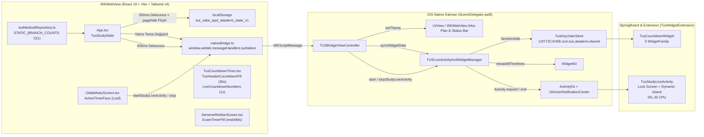

# 02 — Teknik Mimari ve Termal/Performans Optimizasyonu Rehberi (v1.4)

## 1. iOS WKWebView Isınma ve Pil Tüketimi Kök Neden Analizi

v1.3 mimarisi üzerinde yapılan termal ve CPU profilleme incelemesinde, özellikle uzun süreli çalışma oturumlarında (30+ dakika) iPhone cihazlarda ısınmaya ve pil düşüşüne yol açan **4 temel kök neden** saptanmıştır:

| # | Kök Neden | Teknik Etki (v1.3) | v1.4 Çözüm Özeti |
|---|---|---|---|
| **1** | **Kök/Ekran Bileşenlerinde 1 Hz `setInterval`** | `AnalizScreen`, `DenemeRehberScreen` veya üst kapsayıcılarda saniyede bir tetiklenen `setState`, tüm alt bileşen ağaçlarının (11 branş listesi, grafikler, soru listesi) her saniye Virtual DOM diff işlemine girmesine yol açıyordu. | Tüm sayaçlar **yaprak (`React.memo`) bileşenlere** izole edildi (`LiveCountdownNumbers`, `ActiveTimerFace`, `ExamTimerPill`). |
| **2** | **Ağır GPU Compositing Katmanları** | `backdrop-filter: blur(24px) saturate(180%)` ve sürekli çalışan `animate-pulse` animasyonları, WebKit Metal/CoreAnimation katmanında her karede pahalı offscreen render pass tetikliyordu. | `blur(8px)` + yüksek opaklık (`0.92–0.95`) ve sıfır `saturate` / sıfır `animate-pulse` kuralına geçildi. |
| **3** | **Senkron `localStorage` & Sık Native Köprü Çağrısı** | Her cevapta büyük `TusStudyState` JSON'ının senkron `JSON.stringify` ile diske yazılması ve her render döngüsünde `tusNative` köprüsüne tekrarlı mesaj atılması I/O + main-thread blokajı oluşturuyordu. | `350ms` debounced yazım + `visibilitychange`/`pagehide` flush; Widget senkronizasyonu `600ms` debounce; tema senkronizasyonu yalnız değişimde. |
| **4** | **Render Anında $O(N)$ Havuz Taraması** | 11 branşın soru ve spot toplamlarının ekran/karne renderları sırasında tekrar tekrar filtrelenmesi gereksiz CPU döngüsü üretiyordu. | Modül yükleme anında tek seferde hesaplanan `STATIC_BRANCH_COUNTS` $O(1)$ sözlüğü + `React.memo` ekran koruması. |

---

## 2. Uçtan Uca Sistem ve Veri Akışı Mimarisi



---

## 3. Duvar Saati (`startedAtMs` / `endAtMs`) Tabanlı 0-CPU Sayaç Mimarisi

Sayaçlar artık saniye sayacı (`counter++`) tutmaz; mutlak zaman damgalarından (**wall-clock timestamps**) türetilir. Bu sayede ekran kapandığında, uygulama arka plana alındığında veya JS döngüsü durdurulduğunda zaman kayması sıfırdır.

### 3.1. Sayaç İzolasyon Matrisi

| Bileşen | Dosya | Zaman Damgası / Periyot | İzolasyon Stratejisi | Arka Plan Davranışı |
|---|---|---|---|---|
| **`ActiveTimerFace`** | `src/components/OdakModuScreen.tsx` | `startedAtMs: number \| null`, `accumulatedSec: number`, `targetSec: number` | `React.memo` yaprak bileşeni; `1000ms` tick sadece bu küçük DOM düğümünü yeniler | `document.hidden` olduğunda `clearInterval` çağrılır; dönüşte `Date.now() - startedAtMs` ile anında senkronize olur; kilit ekranında SpringBoard devralır |
| **`ExamTimerPill`** | `src/components/DenemeRehberScreen.tsx` | `endAtMs = now + durationMinutes × 60_000` | `React.memo` yaprak bileşeni; `DenemeRehberScreen` soru ağacını yeniden çizmez | Arka planda süre dolmuşsa ön plana dönüşte `rem <= 0` kontrolü `onExpire()` tetikler |
| **`LiveCountdownNumbers`** | `src/components/TusCountdownTimer.tsx` | `parseTusStartMs(dateStr)` (`T10:15:00+03:00`) | `React.memo` ile sarılı (`hero` ve `panel` varyantları) | `useVisibleClockTick(1000)` ile arka planda `0` tick |
| **`TusHeaderCountdownPill`** | `src/components/TusCountdownTimer.tsx` | `useVisibleClockTick(30000)` | Üst barda sadece gün & saat gösterdiği için **30 saniyede 1** güncellenir | Saniye akışı olmadığı için header repaint maliyeti pratik olarak sıfırdır |

### 3.2. `computeElapsedSec` Matematiksel Modeli
```ts
// OdakModuScreen.tsx
function computeElapsedSec(timer: ActiveStudyTimerState, nowMs = Date.now()): number {
  if (!timer.running || !timer.startedAtMs) return timer.accumulatedSec;
  return timer.accumulatedSec + Math.max(0, Math.floor((nowMs - timer.startedAtMs) / 1000));
}
```
- **Duraklatma (`Pause`):** `accumulatedSec` mevcut toplamla güncellenir, `startedAtMs = null`, `running = false` yapılır ve `stopNativeStudyLiveActivity()` çağrılır.
- **Devam (`Resume`):** `startedAtMs = Date.now()`, `running = true` set edilir; `startNativeStudyLiveActivity` içine mevcut `elapsedSeconds` geçirilerek Dynamic Island sayacı kaldığı saniyeden devam ettirilir.

---

## 4. `document.hidden` Görünürlük Yaşam Döngüsü ve Kalıcı Kayıt Protokolü

### 4.1. Timer Görünürlük Döngüsü (`useVisibleClockTick`)
1. Bileşen mount olduğunda `document.hidden === false` ise ilk okuma yapılır ve `setInterval` başlatılır.
2. iOS kullanıcıyı ana ekrana gönderdiğinde veya cihaz kilitlendiğinde `visibilitychange` tetiklenir (`document.hidden === true`) → `clearInterval` ile tüm JS timer döngüleri durdurulur.
3. Uygulama tekrar öne geldiğinde (`document.hidden === false`) `setNowMs(Date.now())` anında çağrılarak gecikmesiz güncel süre hesaplanır ve interval yeniden kurulur.

### 4.2. `350ms` Debounced `localStorage` + Anında Flush (`App.tsx`)
- `studyState` her değiştiğinde `latestStateRef.current` güncellenir ve `350ms` gecikmeli `saveStudyState(latestStateRef.current)` planlanır.
- Ardışık hızlı dokunuşlarda (ör. 55 Konu tur artırma veya hızlı D/Y spot çözümü) yalnızca son durum tek bir `JSON.stringify` + `localStorage.setItem('tus_vaka_spot_akademi_state_v1', ...)` ile diske yazılır.
- Veri kaybını tamamen önlemek için iki sistem olayında **beklemeden senkron flush** çalışır:
  - `document.addEventListener('visibilitychange', () => { if (document.hidden) flushNow(); })`
  - `window.addEventListener('pagehide', flushNow)`

### 4.3. `600ms` Debounced Widget Senkronizasyonu ve Tema Deduplikasyonu
- `syncNativeWidgetSnapshot()` (`App.tsx` satır 118–139), yalnızca widget alanları (`targetTusDate`, `streakDays`, `todaySolvedCount`, `dailyTarget`, `todayStudyMinutes`, `dailyGoalMinutes`) değiştiğinde **`600ms` debounce** ile `syncWidgetData` mesajını Swift katmanına iletir. Böylece arka arkaya çözülen sorularda `WidgetCenter.shared.reloadAllTimelines()` bütçesi gereksiz tüketilmez.
- `syncNativeTheme()` yalnızca `studyState.theme` (`'dark' | 'light'`) değiştiğinde çağrılır; `TUSBridgeViewController.applyTheme` nativede `view`, `webView`, `webView.scrollView` arka plan rengini ve `preferredStatusBarStyle` değerini günceller.

---

## 5. Bellek İndeksleme (`STATIC_BRANCH_COUNTS`) ve GPU Bütçesi

### 5.1. $O(1)$ Branş İndeksleme (`tusMedicalRepository.ts`)
- Uygulama açılışında (modül ilk import edildiğinde) `computeStaticBranchCounts()` tek bir doğrusal tarama ile tüm `11` branş ve `'ALL'` anahtarı için `{ vaka, twin, spot, total }` sayılarını hesaplar ve `STATIC_BRANCH_COUNTS` sabitine dondurur.
- `AnalizScreen.tsx` (11 Branş Ustalık & Soru Dağılımı) her renderda 3.248+ maddelik dizileri taramak yerine `STATIC_BRANCH_COUNTS[b.id]?.total` üzerinden $O(1)$ okuma yapar.

### 5.2. `React.memo` Sayfa Koruması
- Üst bar (`TusHeaderCountdownPill`) veya kardeş state değişimlerinde ağır ekranların gereksiz render edilmesini önlemek için ana görünümler `React.memo` ile sarılmıştır:
  - `AnaSayfaScreen`, `OdakModuScreen`, `VakaTestScreen`, `DogruYanlisScreen`, `TusDynamicCountdownCard`, `TusHeaderCountdownPill`.

### 5.3. GPU `backdrop-filter` Bütçesi (`src/index.css`)
Termal kararlılık için iOS Metal compositing maliyeti aşağıdaki kurallarla sınırlandırılmıştır:

| CSS Sınıfı / Eleman | v1.3 (Eski) | v1.4 (Optimize) | Gerekçe |
|---|---|---|---|
| `.ios-glass-dock-dark` | `blur(24px) saturate(180%)` | `background: rgba(11, 25, 34, 0.94); backdrop-filter: blur(8px)` | Yüksek opaklık + düşük blur yarıçapı ile okunabilirlik korunur, GPU örnekleme alanı ~%89 azalır |
| `.ios-glass-dock-light` | `blur(24px) saturate(180%)` | `background: rgba(255, 255, 255, 0.95); backdrop-filter: blur(8px)` | Gündüz temasında keskin kontrast ve düşük compositing yükü |
| `.ios-glass-header-dark` / `-light` | `blur(24px) saturate(180%)` | `rgba(7,17,23,0.92)` / `rgba(248,250,252,0.93)` + `blur(8px)` | Yapışkan üst bar kaydırma (scroll) sırasında 60/120 Hz ProMotion akıcılığını korur |
| `animate-pulse` | Aktif rozet ve ikonlarda sürekli | **Kaldırıldı** | Sonsuz opaklık animasyonlarının GPU uyanık tutmasını önler |
| `overscroll-behavior: none` | `body` | `html, body, #root` + `webView.scrollView.bounces = false` | WKWebView elastik sıçrama kaynaklı katman yeniden boyamasını engeller |
