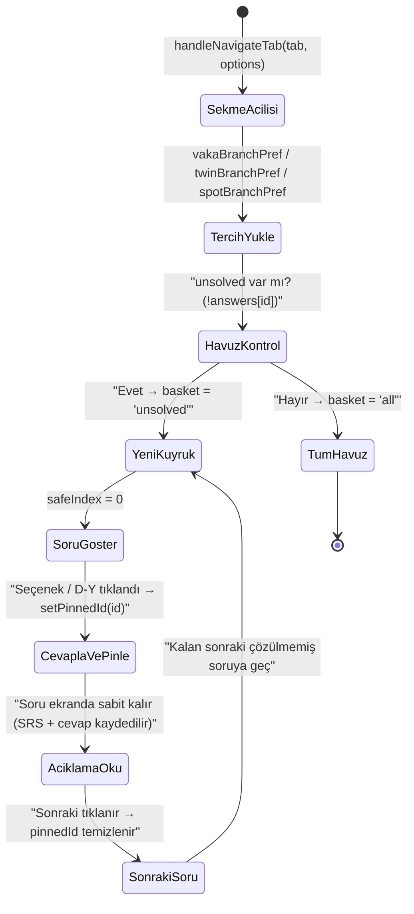

# 03 — Responsive Tasarım Sistemi, Çift Mod (`Akademi ⇄ Odak`) ve ÖSYM Takvimi (v1.4)

## 1. Çoklu Ekran Kırılım Matrisi (`320px` → `1024px`)

Uygulama `max-w-4xl` (`896px`) ana konteyner içinde mobil öncelikli (mobile-first) olarak geliştirilmiştir. Tüm kırılımlarda yatay taşma (`overflow-x: hidden`), metin kırpılması ve dar dokunma alanı önlenir:

| Cihaz / Genişlik | Tailwind Kırılımı | Üst Bar (`h-12`) | Alt Navigasyon | Kart Izgaraları & Şeritler | Yatay Kaydırma (`no-scrollbar`) |
|---|---|---|---|---|---|
| **iPhone SE 1. Nesil (`320px`)** | Varsayılan (`< 640px`) | İkon (`w-7 h-7`) + `[Akademi \| ⚡ Odak]` + Kalan Gün (`Xg`) + Tema + `PRO` (`hidden xs:inline-flex` seri rozeti dar alanda gizlenir) | Mobilde aktif (`Akademi`: 5 öğe, `Odak`: Tek merkez hap) | 1 sütunlu liste; 3'lü özet kutuları (`grid-cols-3 gap-2`) | Yıl, sepet (`QueueBasket`) ve 11 branş hapları yatay kaydırılır |
| **iPhone SE 2/3 & Mini (`375px`)** | Varsayılan (`< 640px`) | Tüm sağ rozetler rahat sığar; `truncate` ile başlık taşmaz | `max-w-md` alt dock / merkez hap `pb-safe` boşluğuyla yerleşir | `Odak` 4 alt sekme (`grid-cols-4 gap-1`) tek satıra sığar | `Vaka` & `Spot` filtreleri tek dokunuşluk haplardır |
| **iPhone 14/15/16 Pro (`393px`)** | Varsayılan (`< 640px`) | `px-2.5 gap-1.5` dengeli boşluk; Dynamic Island safe-area (`pt-safe`) | Başparmak bölgesinde tam erişilebilir `bottom-3` dock | Hero geri sayım kartı sağda `min-w-[104px]` kompakt blok | Kesintisiz 1-satır branş & konu kaydırma |
| **iPhone Pro Max (`430px`)** | Varsayılan (`< 640px`) | Geniş dokunma hedefleri; sıfır sıkışma | `max-w-md` (`448px`) merkezlenmiş alt dock | Rahat okuma satır uzunluğu (`leading-relaxed`) | Hızlı sprint & puan simülatörü kartları |
| **iPad Mini / Air / Pro (`768px–1024px`)** | `sm:` (`640px+`) & `md:` (`768px+`) | Masaüstü/Tablet yatay 7 sekmeli bar (`hidden md:flex`: Ev, Odak, Vaka, Çıkmış İkiz, D/Y Spot, Deneme, Karne) + `Xg Xs` saat | Alt mobil dock & Quick Sheet gizlenir (`md:hidden`) | 2 sütunlu modül & 11 branş kartları (`sm:grid-cols-2`, `sm:grid-cols-3`, `md:grid-cols-2`) | `max-w-4xl mx-auto` merkezli okuma genişliği |

---

## 2. Vaka & Spot Kartlarında 2 Katmanlı Başlık Şeması (Zero-Collision)

### 2.1. Çözülen Çakışma Problemi
Eski tasarımda `[TTBT] [Branş Adı] [★ 2024 TUS İkizi]` rozetleri ile `[💡 İpucu] [🔀] [🔖] [1/30]` araç butonları aynı tek flex satırında yer alıyordu. `320px–375px` genişlikteki ekranlarda uzun branş adları veya `2024 TUS İkizi` rozeti `İpucu` butonuyla çarpışıyor, metinler kırpılıyor veya butonlar kart dışına taşıyordu.

### 2.2. Kalıcı 2 Katmanlı Çözüm (`VakaTestScreen.tsx` & `DogruYanlisScreen.tsx`)

```text
┌────────────────────────────────────────────────────────────────────┐
│ SATIR A (Sabit Araç Çubuğu • border-b • justify-between)          │
│ [TTBT] [Biyokimya (min-w-0 truncate)] │ [💡 İpucu] [🔀] [🔖] [1/N] │
├────────────────────────────────────────────────────────────────────┤
│ SATIR B (Esnek Rozet Şeridi • flex-wrap gap-1.5)                   │
│ [★ 2024 TUS İkizi]   [Enzimler ve Metabolik Yolaklar]              │
├────────────────────────────────────────────────────────────────────┤
│ Klinik İpucu Şeridi (İpucu açıksa) • Soru Metni • A–E Şıkları     │
└────────────────────────────────────────────────────────────────────┘
```

- **Satır A (Araç Çubuğu):** Sol grup `min-w-0 flex-1` ile esner ve branş `shortName` değerini `truncate` ile korur. Sağ grup `shrink-0` ile asla küçülmez (`İpucu` yalnız `VakaTestScreen`'de, `Shuffle`, `Bookmark`, `safeIndex+1/filtered.length`).
- **Satır B (Konu & İkiz Şeridi):** Soru metninin hemen üstünde bağımsız `flex-wrap` satırına taşındı. Böylece `YYYY TUS İkizi` etiketi ile `İpucu` butonu hiçbir ekran genişliğinde aynı yatay ekseni paylaşmaz (`%0` çakışma).
- **Native `<select>` Yerine Hap (Pill) Filtreler:** Soru sepeti (`Yeni`, `Yanlışlar`, `Kayıtlı`, `Tümü`/`Demo`, `Doğrular`/`İkiz`), oturum (`Tüm TUS`, `TTBT`, `KTBT`), yıl (`2019–2025`) ve branş seçimleri taşma yapmayan yatay kaydırmalı hap butonlarla değiştirildi.

---

## 3. "Kaldığın Yeni Sorudan Devam" Durum Makinesi (`Unseen-First`)

Kullanıcı `Ev`, `Vaka`, `Çıkmış` veya `Spot` sekmesine girdiğinde sistem varsayılan olarak çözülmemiş (`unsolved`) soruları önceliklendirir ve branş/yıl tercihlerini `TusStudyState` içinde kalıcı tutar. Ayrıca bir soruyu yanıtladığında sorunun açıklama okunmadan listeden uçmasını önlemek için `pinnedQuestionId` / `pinnedSpotId` mekanizması çalışır.



### Kalıcı Tercih Anahtarları (`TusStudyState`)
| Alan | Tip | Varsayılan | Görevi |
|---|---|---|---|
| `vakaBranchPref` | `'ALL' \| TusBranchId` | `'ALL'` | `Vaka` sekmesindeki son seçilen branşı hatırlar |
| `twinBranchPref` | `'ALL' \| TusBranchId` | `'ALL'` | `Çıkmış İkiz` sekmesindeki son seçilen branşı hatırlar |
| `twinYearPref` | `'ALL' \| '2025' ... '2019'` | `'ALL'` | `Çıkmış İkiz` sekmesindeki son seçilen ÖSYM yılını hatırlar |
| `spotBranchPref` | `'ALL' \| TusBranchId` | `'ALL'` | `D/Y Spot` sekmesindeki son seçilen branşı hatırlar |

---

## 4. OKX TR / Binance Çift Mod Ekran Şemaları (`Akademi ⇄ Odak`)

Üst barda sabit `[Akademi | ⚡ Odak]` anahtarı `uiMode` durumunu yönetir (`handleSwitchMode`).

### 4.1. `Akademi Modu` (Keşif & Çoklu Sekme — 5 Sekmeli Dock)
```text
┌─────────────────────────────────────────────┐
│ [Logo] [Akademi*|⚡ Odak]   [365g] [🔥1] [🌙][PRO] │
├─────────────────────────────────────────────┤
│  Ana Sayfa / Vaka / Çıkmış / Spot / Deneme  │
│  (Aktif içerik alanı — pb-24)               │
├─────────────────────────────────────────────┤
│  [ 🏠 Ev ] [ ☑ Vaka ] [ ⏱ Odak ] [ ✨ Çıkmış ] [ ⚡ Spot ]  │
└─────────────────────────────────────────────┘
```

### 4.2. `Odak Modu` (Sıfır Dikkat Dağınıklığı — Tek Merkez İkon + Bottom Sheet)
```text
┌─────────────────────────────────────────────┐
│ [Logo] [Akademi|⚡ Odak*]   [365g] [🔥1] [🌙][PRO] │
├─────────────────────────────────────────────┤
│ [Kronometre] [Konular] [Tekrar] [Hedef Puan]│
│  • Kronometre: Serbest / 25dk / 50dk + 7g   │
│  • Konular: 55 Konu 0→1→2→3. Tur            │
│  • Tekrar: 4-Kutu SRS + 10'lu Nöbet Sprinti │
│  • Hedef Puan: T-TUS/K-TUS + 17 Dal Bandı   │
├─────────────────────────────────────────────┤
│             ( ⚡ Etüt Menüsü • )            │  ← Tek Merkez İkon
└─────────────────────────────────────────────┘
          ▲ Dokunulunca Açılan Bottom Sheet:
┌─────────────────────────────────────────────┐
│ HIZLI ÇALIŞMA GEÇİŞİ                    [✕] │
│ [⏱ Kronometre & Konular] [☑ Yeni Vaka Çöz]  │
│ [✨ Çıkmış İkizler]     [⚡ Hızlı D/Y Spot] │
│ [🏆 Deneme & Hesap]     [📊 Karne & Analiz] │
│ [       ⊞ Akademi Moduna Geç               ]│
└─────────────────────────────────────────────┘
```

---

## 5. Resmi 2027–2028 ÖSYM TUS Takvimi ve Veri Göçü

Tüm geri sayım bileşenleri (`studyStorage.ts` içindeki `UPCOMING_TUS_EXAMS` ve Swift tarafındaki `TusOfficialSchedule`) **Türkiye Saati (`+03:00`) ile sabah `10:15` oturum başlangıcına** kilitlenmiştir (`parseTusStartMs`: `${dateStr}T10:15:00+03:00`).

| Dönem Adı | Sınav Tarihi & Saati | Başvuru Penceresi | Sonuç Açıklama | Durum |
|---|---|---|---|---|
| **2027-TUS 1. Dönem** | **`2027-03-27T10:15:00+03:00`** (`27 Mart 2027 • 10:15`) | `2–10 Şub 2027` | `22 Nis 2027` | Varsayılan Birincil Hedef |
| **2027-TUS 2. Dönem** | **`2027-08-22T10:15:00+03:00`** (`22 Ağustos 2027 • 10:15`) | `5–13 Tem 2027` | `16 Eyl 2027` | Seçilebilir Aktif Dönem |
| **2028-TUS 1. Dönem** | **`2028-03-26T10:15:00+03:00`** (`26 Mart 2028 • 10:15`) | `Şubat 2028` | `Nisan 2028` | İleri Planlama Dönemi |
| **2028-TUS 2. Dönem** | **`2028-08-20T10:15:00+03:00`** (`20 Ağustos 2028 • 10:15`) | `Temmuz 2028` | `Eylül 2028` | İleri Planlama Dönemi |

### Otomatik Eski Tarih Göçü (`LEGACY_DATE_MIGRATION`)
`loadStudyState()` ve `TusOfficialSchedule.daysRemaining()` içinde önceki sürümlerden kalan placeholder tarihler kullanıcı müdahalesi gerektirmeden otomatik göç ettirilir:
- `2026-03-22` → `2027-03-27`
- `2026-09-20` → `2027-03-27`
- `2027-03-21` → `2027-03-27`
- `2027-09-19` → `2027-08-22`

> Eğer seçili sınav tarihi geçmişte kalmışsa `getNextActiveTusDate()` otomatik olarak sıradaki aktif TUS oturumuna (`examMs > nowMs + 1 saat`) geçiş yapar.
