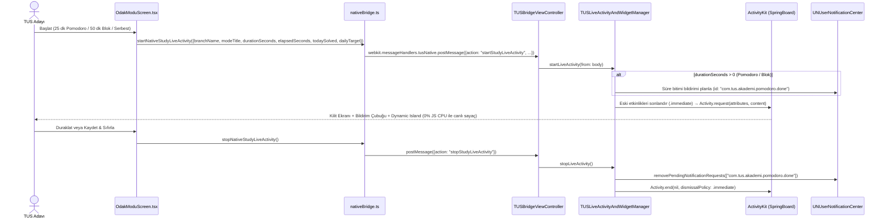

# 04 — Native iOS WidgetKit, Live Activity (Dynamic Island) ve İkon Tasarım Rehberi (v1.4)

## 1. WidgetKit Uzantısı (`TusWidgetExtension` — `com.tus.akademi.widget`)

`ios/App/TusWidgetExtension/TusWidgets.swift` içinde tanımlanan `TusCountdownWidget` (`kind: "TusCountdownWidget"`, görünen ad: `"TUS Geri Sayım & Spot"`), `TusCountdownProvider` (`TimelineProvider`) aracılığıyla **saatlik otomatik zaman çizelgesi (`.after(nextRefresh)`)** ve uygulama içi `WidgetCenter.shared.reloadAllTimelines()` tetiklemesiyle %100 internetsiz çalışır.

### 1.1. Desteklenen 5 Widget Ailesi (`WidgetFamily`) ve Yerleşim Şemaları

| Konum | `WidgetFamily` | Bileşen & Veri Alanları | Görsel Yerleşim Şeması |
|---|---|---|---|
| **Kilit Ekranı** | `accessoryCircular` | `Gauge(value: progressFraction)` (`.accessoryCircularCapacity`) + `daysLeft` (`monospacedDigit`) + `"GÜN"` | `╭───╮` `│127│` (Halka: `todaySolved / dailyTarget`) `│GÜN│` `╰───╯` |
| **Kilit Ekranı** | `accessoryRectangular` | `stethoscope` ikonu + `examShortLabel` (`2027-TUS 1`) + `daysLeft`g `hoursLeft`s + `Bugün: Y/Z Soru` + `Seri: N gün • M dk` | `🩺 2027-TUS 1 • 127g 14s` `Bugün: 18/40 Soru` `Seri: 5 gün • 45 dk` |
| **Kilit Ekranı** | `accessoryInline` | `Label` (`stethoscope` ikonu) + tek satır özet | `🩺 TUS 127g • 18/40` |
| **Ana Ekran (Küçük)** | `systemSmall` | Zümrüt-çam gradyan (`#0A8F6E → #08615C`), `examShortLabel`, büyük `daysLeft` + `"Gün"`, `Hedef Y/Z • Mdk`, `ProgressView` | `┌───────────────┐` `│🩺 2027-TUS 1  │` `│  127 Gün      │` `│Hedef 18/40 45d│` `│██████░░░░░░░░░│` `└───────────────┘` |
| **Ana Ekran (Orta)** | `systemMedium` | Sol blok (`maxWidth: 118`): `examShortLabel`, `daysLeft Gün`, `Y/Z Soru • M dk`. Sağ koyu cam kutu (`Color.black.opacity(0.22)`): `GÜNÜN TUS SPOTU • BRANŞ` + `TusDailySpots.spotOfTheDay()` | `┌──────────┬──────────────────┐` `│2027-TUS 1│GÜNÜN TUS SPOTU   │` `│ 127 Gün  │Gaucher: Beta-glu-│` `│18/40 •45d│koserebrozidaz... │` `└──────────┴──────────────────┘` |

> **Günlük Spot Rotasyonu (`TusDailySpots`):** `TusSharedModels.swift` içinde 11 branşı kapsayan **14 yüksek verimli TUS inci spotu** (`Gaucher`, `Dabigatran/İdarusizumab`, `Winter Formülü`, `Kawasaki`, `Charcot/Reynolds`, `MgSO4/Patella`, `PFK-1`, `Botulizm/SNARE`, `FENa`, `Axiller Sinir`, `DiGeorge`, `Asetaminofen/NAC`, `Goodpasture`, `Menkes`) yılın gün sırasına (`ordinality(of: .day, in: .year) % 14`) göre her gün otomatik döner.

> **iOS 16 / 17+ Uyumluluk:** `tusWidgetBackground` `View` uzantısı, iOS 17+ cihazlarda `.containerBackground(for: .widget)`, iOS 16 cihazlarda `.background()` kullanarak derleme ve görünüm uyumu sağlar.

---

## 2. ActivityKit Canlı Etkinlik (Kilit Ekranı, Bildirim Çubuğu & Dynamic Island)

`App/Info.plist` içinde `NSSupportsLiveActivities = true` aktiftir. `TusStudyLiveActivity` (`ActivityConfiguration(for: TusStudyActivityAttributes.self)`) minimum **iOS 16.2+** üzerinde çalışır.

### 2.1. Uçtan Uca Canlı Etkinlik Veri Akışı

### 2.2. Kilit Ekranı & Dynamic Island Bölgeleri (`TusWidgets.swift`)
- **Kilit Ekranı / Bildirim Çubuğu Kartı:** Koyu derin okyanus arka planı (`rgb(0.04, 0.11, 0.15)`), zümrüt aksan (`rgb(0.2, 0.88, 0.68)`). Solda `modeTitle`, `branchName`, `Hedef: todaySolved/dailyTarget Soru`; sağda `26pt` kalın `monospacedDigit()` geri sayım (`Text(timerInterval: timerStart...safeEnd, countsDown: true)`) veya serbest kronometre (`Text(timerStart, style: .timer)`) + `"ETÜT AKTİF"`.
- **Dynamic Island Bölgeleri:**
  - `expanded.leading`: `Label(branchName, systemImage: "stethoscope")`
  - `expanded.trailing`: `18pt` `monospacedDigit` canlı sayaç
  - `expanded.bottom`: `modeTitle • Bugün: X/Y Soru`
  - `compactLeading`: Zümrüt `stethoscope` ikonu
  - `compactTrailing`: `12pt` `monospacedDigit` canlı süre
  - `minimal`: Zümrüt `stethoscope` ikonu
- **Termal Avantaj:** Süre akışı tamamen iOS `SpringBoard` tarafından sistem saatine göre çizilir; uygulama arka plandayken JavaScript motoru tamamen uyur (**%0 JS CPU**).

---

## 3. Hedefler Arası Güvenli Keychain Paylaşım Protokolü

`App` (`com.tus.akademi`) ve `TusWidgetExtension` (`com.tus.akademi.widget`) hedefleri arasındaki veri paylaşımı, Apple Developer Portal'da ek bir App Group kaydı gerektirmeyen **Keychain Access Group** mimarisiyle çözülür:

- **Entitlements (`App.entitlements` & `TusWidgetExtension.entitlements`):**
  - `keychain-access-groups`: `$(AppIdentifierPrefix)com.tus.akademi.shared` (Dağıtım Takım ID'si ile `U3YT2CXH58.com.tus.akademi.shared`)
- **Depolama Anahtarları (`TusKeychainStore` — `ios/App/Shared/TusSharedModels.swift`):**
  - `kSecAttrService`: `"com.tus.akademi.widget.snapshot"`
  - `kSecAttrAccount`: `"snapshot_v1"`
  - `kSecAttrAccessGroup`: `"U3YT2CXH58.com.tus.akademi.shared"`
  - `kSecAttrAccessible`: `kSecAttrAccessibleAfterFirstUnlock` (Cihaz kilitliyken dahi WidgetKit'in arka plan zaman çizelgesini okuyabilmesi için)
  - **Simülatör / Yetkisiz Ortam Yedeği:** `SecItemAdd` başarısız olursa (`status != errSecSuccess`), `UserDefaults.standard` üzerinden `com.tus.akademi.widget.snapshot` anahtarına yedeklenir.

### `TusWidgetSnapshot` Veri Şeması (`Codable`)
| Alan | Swift Tipi | JS Kaynağı (`WidgetSnapshotPayload`) | Varsayılan Değer |
|---|---|---|---|
| `targetTusDate` | `String` | `info.effectiveDate` | `"2027-03-27"` |
| `examLabel` | `String` | `info.examLabel` | `"2027-TUS 1. Dönem"` |
| `streakDays` | `Int` | `studyState.streakDays` | `1` |
| `todaySolved` | `Int` | `studyState.todaySolvedCount` | `0` |
| `dailyTarget` | `Int` | `studyState.dailyTarget` | `40` |
| `todayStudyMinutes` | `Int` | `Math.round(studySecondsByDate[today] / 60)` | `0` |
| `dailyGoalMinutes` | `Int` | `studyState.dailyGoalMinutes` | `120` |
| `updatedAt` | `Date` | `Date()` (Swift enjeksiyonu) | Anlık zaman |

---

## 4. 4096 → 1024px LANCZOS Geometrik Vektör Uygulama İkonu Şartnamesi

Yapay zeka (AI) üretim izi taşıyan parlak 3D plastik dokular tamamen terk edilerek `scripts/generate_clean_icon.py` ile deterministik, İsviçre/Apple HIG uyumlu geometrik vektör ikon üretimi kurulmuştur.

### 4.1. Görsel ve Teknik Parametreler (`scripts/generate_clean_icon.py`)
1. **Çalışma Tuvali (`SIZE = 4096`):** Anti-aliasing ve Bezier eğri keskinliği için `4096×4096` çözünürlükte çizilir.
2. **Arka Plan Gradyanı (`make_diagonal_gradient`):**
   - `512×512` matris üzerinde sıfır renk şeritlenmesi (zero banding) için hesaplanıp `BICUBIC` ile `4096` piksele büyütülür:
   - Üst-Sol Gün Işığı Nane: `#D0FFF2` `(208, 255, 242)`
   - Orta Turkuaz: `#34E0BE` `(52, 224, 190)`
   - Alt-Sağ Zümrüt: `#0EAE82` `(14, 174, 130)`
   - Üst-sol güneş parıltısı (`glow = 0.22`) ve `%6` opaklıkta ince geometrik arka plan halka çizgileri.
3. **Merkez Beyaz Squircle Kart:**
   - `card_margin = 690`, `card_radius = 680`, hafif zümrüt gölge (`rgba(6, 95, 70, 56)`, `GaussianBlur(radius=90)`), saf beyaz dolgu (`rgba(255, 255, 255, 250)`).
4. **Geometrik Tıbbi Amblem:**
   - Kübik Bezier (`cubic_bezier`, `stroke = 185`) ile çizilen steteskop kolları (`#059669`), kulaklık uçları (`#047857`), kıvrımlı hortum (`#14B8A6`) ve çift halkalı dinleme tamburu.
   - Sıcak mercan odak noktası ve üst merkezde yuvarlatılmış İsviçre tıbbi artısı (`#FF6B4A`, `arm_w = 136`, `arm_l = 350`, `radius = 52`).
5. **App Store Connect Zorunlu Çıktı Doğrulaması (`Image.Resampling.LANCZOS` + Strict RGB):**
   - `ios/App/App/Assets.xcassets/AppIcon.appiconset/AppIcon-512@2x.png` → `1024×1024`, mode `RGB` (alfa kanalı **KESİNLİKLE YOK**).
   - `public/icon-512.png` → `512×512`, mode `RGB`.
   - `public/icon-192.png` → `192×192`, mode `RGB`.
   - Script her çıktı sonunda `assert check.size == (dim, dim)` ve `assert check.mode == "RGB"` doğrulaması yapar.
