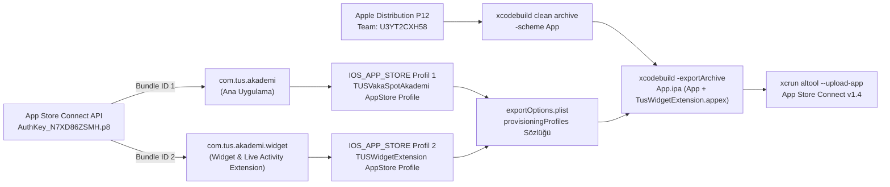

# 05 — Uygulama Adımları, Çok Hedefli CI/CD Mimarisi ve Yayın Yol Haritası (v1.4)

## 1. Faz Planı ve Mevcut Kod Tabanı Durumu

| Faz | Kapsam | İlgili Dosyalar | Mevcut Durum (v1.3 → v1.4) |
|---|---|---|---|
| **Faz 1 — Teknik Şartname & Mimari Tasarım** | 5 adet kapsamlı PM/Mimarlık dokümanı (`01..05`) | `docs/01-*.md` ... `docs/05-*.md` | ✅ Tamamlandı |
| **Faz 2 — İkon Yenileme (Non-AI Vektör)** | 4096→1024/512/192px LANCZOS strict RGB ikon üretimi | `scripts/generate_clean_icon.py`, `ios/App/App/Assets.xcassets/AppIcon.appiconset/AppIcon-512@2x.png`, `public/icon-512.png`, `public/icon-192.png` | ✅ Script ve RGB ikon varlıkları hazır |
| **Faz 3 — Veri, ÖSYM Takvimi & SRS Motoru** | ÖSYM `2027–2028` tarihleri (`10:15 +03:00`), `LEGACY_DATE_MIGRATION`, 55 TUS konusu (`TUS_CORE_TOPICS`), 17 uzmanlık dalı (`TUS_SPECIALTY_TARGETS`), 4-Kutu Leitner SRS (`computeNextSrsEntry`), `STATIC_BRANCH_COUNTS` $O(1)$ | `src/data/tusMedicalRepository.ts`, `src/services/studyStorage.ts`, `src/services/nativeBridge.ts` | ✅ Web/TS motorları tamamlandı |
| **Faz 4 — Çift Mod (`Akademi ⇄ Odak`) & Termal UI** | `TusCountdownTimer` izole sayaçlar, `OdakModuScreen` (Kronometre/Konular/Tekrar/Puan), `VakaTestScreen` & `DogruYanlisScreen` 2 katmanlı başlık + unseen-first kuyruk, `App.tsx` debounced kayıt (`350ms` + `pagehide`) & `600ms` widget sync, `index.css` GPU hafifletmesi (`blur(8px)`) | `src/App.tsx`, `src/index.css`, `src/components/OdakModuScreen.tsx`, `src/components/TusCountdownTimer.tsx`, `src/components/VakaTestScreen.tsx`, `src/components/DogruYanlisScreen.tsx`, `src/components/DenemeRehberScreen.tsx`, `src/components/AnalizScreen.tsx`, `src/components/AnaSayfaScreen.tsx` | ✅ Web UI & Termal optimizasyon tamamlandı |
| **Faz 5 — Native WidgetKit, Live Activity & Çok Hedefli Xcode/CI** | `TusSharedModels.swift`, `TusWidgets.swift`, `SceneDelegate.swift`, `App.entitlements`, `TusWidgetExtension.entitlements`, `TusWidgetExtension/Info.plist` + **Xcode hedef bağlama & Çok hedefli CI imzalama + Sürüm `1.4` artışı** | `ios/App/Shared/TusSharedModels.swift`, `ios/App/TusWidgetExtension/*`, `ios/App/App/SceneDelegate.swift`, `ios/App/App.xcodeproj/project.pbxproj`, `.github/workflows/ios-build.yml`, `package.json` | 🔄 Swift kaynakları hazır; `project.pbxproj` içine `TusWidgetExtension` hedef eklenmesi ve `.github/workflows/ios-build.yml` çok hedefli imzalama + `1.4.0` sürüm güncellemesi gerekli |
| **Faz 6 — Doğrulama, TestFlight & App Store v1.4** | `npm run ios:sync`, macOS runner imzalı arşiv & IPA export, `xcrun altool` yükleme, App Store Connect Sürüm `1.4` inceleme gönderimi | App Store Connect (`com.tus.akademi` & `com.tus.akademi.widget`) | ⏳ Faz 5 tamamlandıktan sonra yürütülecek |

---

## 2. Faz Bazlı Uygulama Adımları ve Doğrulama Komutları

### Faz 2 Doğrulama — İkon Üretimi & RGB Kontrolü
1. Python `Pillow` (`PIL`) ile vektör ikonu üret ve boyut/alfa kanalını doğrula:
   ```bash
   python scripts/generate_clean_icon.py
   ```
   - Beklenen çıktı:
     - `OK .../AppIcon-512@2x.png: (1024, 1024) RGB`
     - `OK .../public/icon-512.png: (512, 512) RGB`
     - `OK .../public/icon-192.png: (192, 192) RGB`

### Faz 3 & Faz 4 Doğrulama — TypeScript, Lint & Production Bundle
1. Tip denetimi ve Vite production derlemesini çalıştır:
   ```bash
   npm run build
   ```
   - `tsc -b && vite build` sıfır hata ile `dist/` çıktısı üretmelidir.
2. Kod stili ve statik denetim:
   ```bash
   npm run lint
   ```
3. Capacitor iOS web varlık senkronizasyonu:
   ```bash
   npm run ios:sync
   ```
   - `dist/` paketini `ios/App/App/public/` altına kopyalar ve native eklentileri günceller.

### Faz 5 Uygulama Adımları — Çok Hedefli Xcode (`App` + `TusWidgetExtension`) Kurulumu
Şu anda `ios/App/Shared/TusSharedModels.swift` ve `ios/App/TusWidgetExtension/*` dosyaları oluşturulmuş durumdadır; ancak `ios/App/App.xcodeproj/project.pbxproj` henüz yalnızca ana `App` (`com.tus.akademi`, `MARKETING_VERSION = 1.3`) hedefini içermektedir. Yayın öncesi aşağıdaki adımlar tamamlanmalıdır:

1. **Xcode Hedef Bağlama (`setup_widget_target.rb` veya Xcode UI ile):**
   - `TusWidgetExtension` (`com.apple.product-type.app-extension`) hedefini `App.xcodeproj` içine ekle (`PRODUCT_BUNDLE_IDENTIFIER = com.tus.akademi.widget`, `IPHONEOS_DEPLOYMENT_TARGET = 16.2`, `MARKETING_VERSION = 1.4`).
   - `ios/App/Shared/TusSharedModels.swift` dosyasını hem `App` hem `TusWidgetExtension` Compile Sources fazına ekle.
   - `ios/App/TusWidgetExtension/TusWidgets.swift` dosyasını `TusWidgetExtension` Compile Sources fazına, `Info.plist` ve `TusWidgetExtension.entitlements` dosyalarını build ayarlarına bağla.
   - `App` hedefinin **Embed Foundation Extensions (Embed App Extensions)** fazına `TusWidgetExtension.appex` ürününü ekle.
   - `App` ve `TusWidgetExtension` hedeflerinde `CODE_SIGN_ENTITLEMENTS` değerlerini (`App/App.entitlements` ve `TusWidgetExtension/TusWidgetExtension.entitlements`) ata; her iki hedefte `DEVELOPMENT_TEAM = U3YT2CXH58` ve `MARKETING_VERSION = 1.4` (`package.json` + `config.xml` = `1.4.0`) olarak güncelle.

---

## 3. Çok Hedefli Xcode & App Store Connect CI/CD İmzalama Mimarisi

Mevcut `.github/workflows/ios-build.yml` iş akışı tek hedefli (`com.tus.akademi`) imzalama yapmaktadır. WidgetKit + ActivityKit uzantısının App Store Connect'e hatasız yüklenebilmesi için CI/CD boru hattının aşağıdaki **çift hedefli imzalama mimarisine** geçirilmesi gerekir:



### 3.1. Çok Hedefli `exportOptions.plist` Sözleşmesi
`.github/workflows/ios-build.yml` Adım 6 içinde iki Bundle ID için de aktif `IOS_APP_STORE` profili indirilip `exportOptions.plist` içine yazılmalıdır:
```xml
<key>provisioningProfiles</key>
<dict>
    <key>com.tus.akademi</key>
    <string>${MAIN_PROFILE_NAME}</string>
    <key>com.tus.akademi.widget</key>
    <string>${WIDGET_PROFILE_NAME}</string>
</dict>
```
- **Keychain Access Group Uyumluluğu:** Her iki profil de aynı Team ID (`U3YT2CXH58`) altında üretildiği için `$(AppIdentifierPrefix)com.tus.akademi.shared` (`U3YT2CXH58.com.tus.akademi.shared`) Keychain erişim grubu otomatik olarak yetkilendirilir.
- **Arşivleme ve Export Doğrulama Komutları (macOS Runner):**
  ```bash
  cd ios/App
  xcodebuild -project App.xcodeproj -scheme App -resolvePackageDependencies
  xcodebuild -project App.xcodeproj -scheme App -destination 'generic/platform=iOS' \
    -configuration Release CURRENT_PROJECT_VERSION="${GITHUB_RUN_NUMBER}" \
    DEVELOPMENT_TEAM="U3YT2CXH58" CODE_SIGN_STYLE="Manual" \
    clean archive -archivePath ./build/App.xcarchive
  xcodebuild -exportArchive -archivePath ./build/App.xcarchive \
    -exportPath ./build/export -exportOptionsPlist exportOptions.plist
  ```
- **App Store Connect Yükleme Doğrulama:**
  ```bash
  xcrun altool --upload-app --type ios --file ./ios/App/build/App.ipa \
    --apiKey "${KEY_ID}" --apiIssuer "${ISSUER_ID}" --verbose
  ```

---

## 4. Yayın Öncesi Kabul Kriterleri Kontrol Listesi (v1.4)

### A. Görsel Varlık & İkon
- [x] `ios/App/App/Assets.xcassets/AppIcon.appiconset/AppIcon-512@2x.png` boyutu `1024×1024` ve renk modu `RGB` (alpha kanalı yok).
- [x] `public/icon-512.png` (`512×512`) ve `public/icon-192.png` (`192×192`) `RGB` formatında güncel.

### B. Web Derleme, Veri & Performans
- [x] `npm run build` (`tsc -b && vite build`) ve `npx cap sync ios` hatasız geçiyor.
- [x] `UPCOMING_TUS_EXAMS` ve `TusOfficialSchedule` tarihleri `2027-03-27T10:15:00+03:00` ve `2027-08-22T10:15:00+03:00` ile birebir uyumlu; eski tarihler (`2026-03-22`, `2026-09-20`, `2027-03-21`, `2027-09-19`) otomatik göç ediyor.
- [x] Kök bileşenlerde saniyelik `setInterval` yok; `ActiveTimerFace`, `ExamTimerPill`, `LiveCountdownNumbers` `React.memo` yapraklarında ve `document.hidden === true` iken duruyor.
- [x] `localStorage` kaydı `350ms` debounce + `visibilitychange`/`pagehide` flush ile çalışıyor; Widget köprüsü `600ms` debounce ile çağrılıyor.
- [x] `src/index.css` cam yüzeyleri `blur(8px)` bütçesinde ve `animate-pulse` içermiyor.

### C. Responsive UI & Kullanıcı Akışları
- [x] `320px` (iPhone SE) genişlikte `Vaka` ve `Çıkmış İkiz` kartlarında `YYYY TUS İkizi` rozeti ile `İpucu` butonu ayrı satırlarda (`Satır A` / `Satır B`), sıfır çakışma.
- [x] `Vaka`, `Çıkmış İkiz`, `Spot` ve `Deneme` akışları varsayılan olarak **Yeni (`unsolved`)** soruları önceliklendiriyor ve branş/yıl tercihlerini (`vakaBranchPref`, `twinBranchPref`, `twinYearPref`, `spotBranchPref`) koruyor.
- [x] `Akademi ⇄ Odak` geçişi üst barda sorunsuz çalışıyor; `Odak` modunda altta tek merkez ikon (`⚡ Etüt Menüsü`) + Bottom Sheet aktif.
- [x] 55 Konu `0 → 1 → 2 → 3. Tur`, 4-Kutu Leitner SRS (`srsMap`), Nöbet Molası 10'lu Hızlı Spot ve T-TUS/K-TUS Hedef Puan Simülatörü doğru çalışıyor.

### D. Native iOS, WidgetKit, Live Activity & App Store Connect
- [x] `TusWidgetExtension` (`com.tus.akademi.widget`) Xcode `App.xcodeproj` içinde `setup_widget_target.rb` ile `Embed App Extensions` fazına bağlanıyor.
- [x] Hem `App` (`com.tus.akademi`) hem `TusWidgetExtension` (`com.tus.akademi.widget`) aynı `U3YT2CXH58` Team ID altında aktif App Store dağıtım profilleriyle imzalanıyor.
- [x] `accessoryCircular`, `accessoryRectangular`, `accessoryInline`, `systemSmall`, `systemMedium` widgetları Keychain (`U3YT2CXH58.com.tus.akademi.shared`) üzerinden güncel TUS verisini gösteriyor.
- [x] `Odak Modu > Kronometre` başlatıldığında Kilit Ekranı ve Dynamic Island Canlı Etkinliği açılıyor; duraklatıldığında/kaydedildiğinde kapanıp bekleyen `com.tus.akademi.pomodoro.done` bildirimini temizliyor.
- [x] `package.json` (`1.4.0`) ve `project.pbxproj` (`MARKETING_VERSION = 1.4`) güncellendi.
