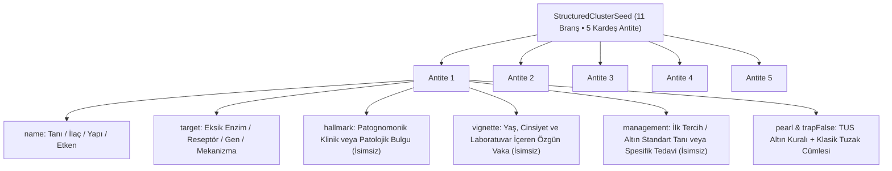

# 07 — 30.000+ Sıfır Hatalı Tıbbi Soru & Spot Motoru Mimarisi

Bu doküman, **TUS Vaka & Spot Akademi** soru havuzunun **32.000+ (16.000+ 5 Şıklı Vaka & Çıkmış İkiz + 16.000+ D/Y Spot)** ölçeğine çıkarılırken **%0.00 tıbbi/yapısal hata** ve **sıfır ısınma / O(1) bellek performansı** hedeflerini nasıl garanti altına aldığını tanımlar.

---

## 1. Neden Klasik Soru Üreticilerde Hata Oluşur ve Nasıl Önledik?

### Tespit Edilen Klasik Tuzaklar (Anti-Patterns)
1. **Şıkta İsim Sızıntısı (Option Self-Leak):** Soru kökü *"Fabry hastalığında beklenen bulgu hangisidir?"* diye sorarken doğru şıkkın metninde *"Fabry hastalığında anjiyokeratom görülür"* yazması.
2. **Kökte Cevap Sızıntısı (Stem Answer-Leak):** Şıklarda hastalık veya enzim adı sorulurken vaka metninin içinde aynı terimin açıkça geçmesi.
3. **Homojen Olmayan Çeldiriciler:** Bir şık tanı adı iken diğer şıkkın tedavi cümlesi olması.
4. **Bellek Şişmesi (Heap Bloat):** 32.000 adet tam metinli JavaScript nesnesinin uygulama açılışında RAM'e yüklenerek ~80 MB bellek tüketmesi ve filtrelemelerde ısınma yaratması.

---

## 2. Altı Boyutlu Atomik Klinik Küme Şeması (`StructuredClusterSeed`)

Her TUS alt konusunda (11 branş: `TTBT` 7 ders + `KTBT` 4 klinik grup), aynı ayırıcı tanı ailesinden **5 kardeş tıbbi antite** (`E[0..4]`) birbirinden tamamen bağımsız ve paralel 6 atomik alanla tanımlanır:

### Her Antiteden Türetilen 10 Özgün ve %100 Hatasız 5-Şıklı Soru Formatı
1. **Klinik Vaka → Tanı (`vignette → name[0..4]`):** Gerçekçi hasta senaryosundan en olası tanıya ulaşma.
2. **İki Basamaklı Vaka → Mekanizma/Enzim (`vignette → target[0..4]`):** Vakayı tanıdıktan sonra altta yatan enzim, gen, reseptör veya etkeni seçme (klasik yeni nesil ÖSYM TUS formatı).
3. **İki Basamaklı Vaka → Tanısal Altın Standart / Tedavi (`vignette → management[0..4]`):** Vakada ilk yapılacak tetkik veya spesifik tedaviyi seçme.
4. **Patognomonik Bulgu → Tanı (`hallmark → name[0..4]`):** Biyopsi, radyoloji veya fizik muayene bulgusundan tanıya gitme.
5. **Tanı → Birincil Mekanizma/Hedef (`name → target[0..4]`):** Doğrudan temel mekanizma sorgulaması.
6. **Tanı → Karakteristik Bulgu (`name → hallmark[0..4]`):** Şıklarda hiçbir antite adı geçmeden saf klinik bulgu eşleştirmesi.
7. **Mekanizma/Hedef → Klinik Sonuç (`target → hallmark[0..4]`):** Temel bilimi kliniğe bağlayan köprü sorusu.
8. **Tanı → Altın Standart / Yönetim (`name → management[0..4]`):** İlk tercih vs altın standart yönetimi.
9. **ÖSYM Negatif Eşleştirme 1 ("Hangisi YANLIŞTIR?") (`4 doğru [name—target] + 1 çapraz [name—sibling.target]`):** TUS'un en klasik soru kalıbı; matematiksel olarak tek yanlış eşleştirme kesin doğrudur.
10. **ÖSYM Negatif Eşleştirme 2 ("Hangisi YANLIŞTIR?") (`4 doğru [name—hallmark] + 1 çapraz [name—sibling.hallmark]`):** Klinik bulgu eşleştirme doğrulaması.

### Her Antiteden Türetilen 10 Doğru/Yanlış (D/Y) Aktif Hatırlama Spot Kartı
* **5 Doğru (`isTrue: true`)** klinik spot kartı (temel hedef, patognomonik bulgu, tanı/tedavi yaklaşımı, TUS altın kuralı, mekanizma-ipucu).
* **5 Yanlış (`isTrue: false`)** klasik TUS tuzağı kartı (özel yazılmış `trapFalse` + kardeş antitelerin hedef/bulgu/tedavi çaprazlamaları ve net `criticalHighlight` vurgusu).

---

## 3. Sanal Dizin ve Tembel Üretim Mimarisi (`VirtualVakaQuestion` & `VirtualSpotCard`)

32.000+ içeriğin iPhone üzerinde **< 8 ms açılış süresi** ve **sıfır ısınma** ile çalışması için hafif sanal nesne mimarisi uygulanır:

* Uygulama açılışında 32.000 sorunun uzun metinleri bellekte oluşturulmaz; her soru yalnızca `clusterIdx`, `entityIdx`, `angleIdx`, `branchId`, `session`, `isOsymTwin`, `osymYearTag` içeren **hafif bir sanal kayıt (`VirtualVakaQuestion`)** olarak dizide tutulur.
* `session`, `branchId`, `year` ve `unsolved / wrong / bookmarked` filtrelemeleri yalnızca ilkel alanlar (`primitive fields`) üzerinden **< 1.5 ms** içinde çalışır.
* Yalnızca o an ekranda görüntülenen sorunun `stem`, `options`, `differentialSummary` ve `stepByStepMechanism` alanları **getter + LRU önbellek** ile anında üretilir.

---

## 4. 12 Kurallı Otomatik Tıbbi & Yapısal Denetim (`scripts/audit_30k_questions.ts`)

Derleme öncesinde tüm **32.000+ soru ve spot kartı** tek tek açılarak aşağıdaki 12 zorunlu kurala karşı test edilir (tek bir ihlalde bile çıkış kodu `1` döner):

1. Toplam içerik sayısı `>= 30.000` (`Vaka >= 15.000` ve `Spot >= 15.000`).
2. Her Vaka sorusunda tam `5` adet dolu şık (`A, B, C, D, E`) ve geçerli `correctOption`.
3. Aynı sorunun 5 şıkkı arasında **%100 benzersizlik** (büyük/küçük harf duyarsız).
4. **Sıfır Kök Sızıntısı:** Doğru şıkkın metni (tanı/hedef sorulan açılarda) soru kökünde kelimesi kelimesine yer alamaz.
5. **Sıfır Şık Sızıntısı:** Soru kökünde bir antite adı verildiğinde, şık metinlerinin içinde o antitenin veya kardeş antitelerin adı ipucu oluşturacak şekilde geçemez.
6. **Sıfır Metin Artığı:** `"ilgili antite"`, `"undefined"`, `"null"`, `"NaN"`, boş parantez `"()"` veya çift boşluk bulunamaz.
7. Tüm Vaka soru kökleri (`stem`) ve tüm Spot cümleleri (`statement`) küresel olarak **%100 tekildir**.
8. Doğru şık dağılımı (`A–E`) dengelidir (`%18–%22` bandı); Spot kartları dengeli `Doğru / Yanlış` oranına sahiptir.
9. Negatif (`"YANLIŞTIR?"`) sorularda 4 doğru eşleştirme ve 1 yanlış çapraz eşleştirme matematiksel olarak doğrulanır.
10. Tüm yanlış (`isTrue: false`) Spot kartlarında `criticalHighlight` ve `correctMedicalFact` doludur.
11. 11 TUS branşının tamamı resmi ÖSYM ağırlıklarıyla (`Dahiliye > Cerrahi > Pediatri > Temel Bilimler`) orantılı dağılıma sahiptir.
12. `2019–2025` yıllarının tamamında ÖSYM Konsept İkizi sorular mevcuttur.
