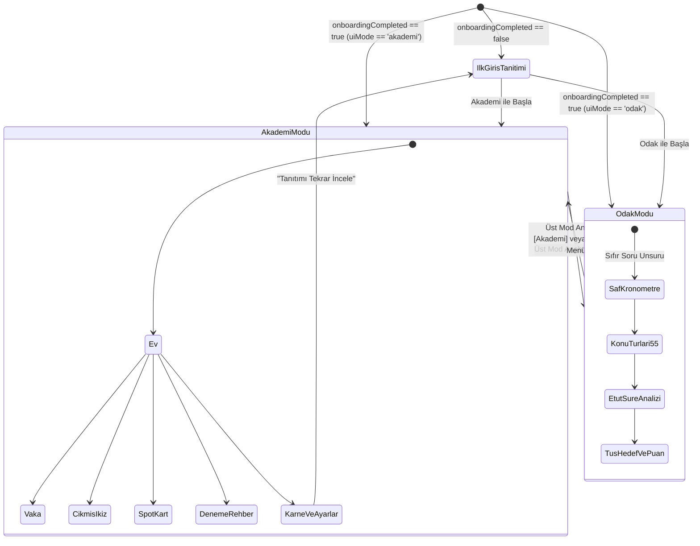

# 08 — Saf Odak Modu, Sıfır Tekrarlı Arayüz ve İlk Giriş Tanıtım Mimarisi

Bu doküman; **Akademi ⇄ Odak** mod geçişinin pürüzsüzleştirilmesi, **Odak** ekranının soru unsurlarından %100 yalıtılması, uygulama genelindeki mükerrer (iki kez görünen) bileşenlerin temizlenmesi ve **İlk Giriş Tanıtım (Onboarding)** akışının teknik tasarımını içerir.

---

## 1. Mükerrer Bileşenlerin Temizlenmesi (Zero-Duplication Audit)

| Ekran / Alan | Eski Durum (Tekrar Eden Yapı) | Yeni Sadeleştirilmiş Mimari |
| :--- | :--- | :--- |
| **Üst Bar vs Ana Kart** | Hem üst barda `127G` + `🔥 Seri`, hem 12px altındaki Hero kartta tekrar `127 GÜN` + `🔥 Seri` | Üst bar yalnızca `[Akademi \| Odak]` anahtarı, Tema, Karne/Ayarlar ve PRO taşır; geri sayım ve seri yalnızca ilgili ana kartta tekil görünür |
| **Akademi Alt Navigasyon** | Üstte `Odak` anahtarı varken alt barda da 3. sekme olarak `Odak` yer alması | `Akademi` alt barı yalnızca 5 saf soru/sınav sekmesinden oluşur: **`Ev • Vaka • Çıkmış • Spot • Deneme`** |
| **Ana Sayfa Kartları** | Hero kartta `"Yeni Vaka Çöz"`, altında `"Odak"` kartı, altında tekrar `"Vaka Soruları"`, en altta tekrar `"Hata Defteri"` | Hero kart (Geri Sayım + Günlük Hedef) → 4 Net Modül Kartı (`Vaka`, `Çıkmış`, `Spot`, `Deneme`) → 11 Branş Izgarası |
| **Odak Alt Menüsü** | `Odak` modundaki alt menüde `"Yeni Vaka Çöz"`, `"Çıkmış İkizler"`, `"Hızlı Spot"` gibi soru butonlarının çıkması | `Odak` alt merkez ikonu **yalnızca saf etüt araçlarını** (`Kronometre`, `Konu Turları`, `Süre Analizi`, `Hedef & Puan`, `Akademi'ye Geç`) listeler |

---

## 2. `Akademi ⇄ Odak` İkili Evren Mimarisi

### `Odak` Modu Katı Tasarım Kuralları ("Soru İle İlgili Hiçbir Kısım Görünmesin")
1. **Görünmeyecek Unsurlar:** Soru sayacı (`0/40 soru`), `"Yeni Vaka Çöz"` bağlantısı, `"Vaka Yanlış / Spot Yanlış"` butonları, `"10 Hızlı Spot"` mini testi ve soru bankası sekmeleri `Odak` modundan tamamen kaldırılmıştır.
2. **Görünecek Saf Etüt Araçları (`OdakModuScreen.tsx`):**
   * **Süre (Saf Kronometre & Pomodoro):** `Serbest`, `25 dk Pomodoro`, `50 dk Blok` ve `90 dk Derin Blok` modları, 11 TUS dersi etiketi, büyük dingin sayaç yüzü, `Başlat / Duraklat / Etüdü Kaydet` ve Kilit Ekranı Canlı Etkinliği.
   * **Konular (11 Branş • 55 Çekirdek Konu Turu):** `Tümü / TTBT / KTBT` filtreli `0 → 1. Tur → 2. Tur → 3. Tur ✓` konu bitirme takibi + branş bazlı çalışılan süre rozeti.
   * **Analiz (Etüt Süresi & Takvim):** Günlük etüt hedefi seçici (`120 / 180 / 240 / 360 dk`), son 7 günlük çalışma çubuk grafiği ve 11 branşın toplam çalışma saati dağılımı.
   * **Hedef (TUS Dönemi, Uzmanlık Dalı & Puan Simülatörü):** Resmi 2027–2028 TUS takvimi, 17 uzmanlık dalı hedef puanı, K-TUS / T-TUS net simülatörü ve iOS Kilit Ekranı Widget kurulum rehberi.
3. **Alt Navigasyon Barı (`Odak` Modunda Tek Merkez İkon):**
   * OKX TR / Binance mantığıyla alt barda yalnızca **tek bir merkez odak kapsülü (`◎ Odak Menüsü`)** yer alır; dokunulduğunda 4 saf odak bölümü arasında geçiş yapar veya tek dokunuşla `Akademi` moduna döndürür.

---

## 3. İlk Giriş Tanıtım Ekranı (`OnboardingModal.tsx`) ve Ayarlar Entegrasyonu

* **Kalıcılık Alanı (`TusStudyState`):** `onboardingCompleted: boolean` (`localStorage` üzerinde saklanır).
* **Tetiklenme Kuralı:**
  * İlk açılışta (`!studyState.onboardingCompleted`) tam ekran, sade ve akıcı bir karşılama katmanı olarak açılır.
  * Kullanıcı **"Atla"** veya son adımdaki **"Başla"** butonuna dokunduğunda `onboardingCompleted: true` kaydedilir ve sonraki açılışlarda bir daha gösterilmez.
  * **Karne & Ayarlar (`AnalizScreen.tsx`)** ekranındaki **Uygulama Rehberi & Ayarlar** kartında yer alan **"Uygulama Tanıtımını Tekrar İncele"** butonu ile her zaman yeniden açılabilir (mevcut çalışma verilerini sıfırlamaz).
* **4 Adımlık Minimalist Akış:**
  1. **32.000+ %100 Hatasız Çevrimdışı TUS Külliyatı:** 11 branşta 5 şıklı vakalar, 2019–2025 ÖSYM ikizleri ve D/Y spot kartları.
  2. **İki Ayrı Çalışma Evreni (`Akademi` ⇄ `Odak`):** Soru çözümü için `Akademi`, sorulardan arındırılmış saf kronometre ve konu takibi için tek ikonlu `Odak` modu.
  3. **Kilit Ekranı Widgetları & Yeni Sorudan Devam:** iOS Kilit Ekranı / Dynamic Island canlı sayaçları ve çözülmüş soruları tekrar göstermeyen akıllı sıra.
  4. **Hedefini Seç & Başla:** Hedef TUS dönemi (`2027-TUS`), hedef uzmanlık dalı ve başlangıç modu (`Akademi` veya `Odak`) seçimi.
